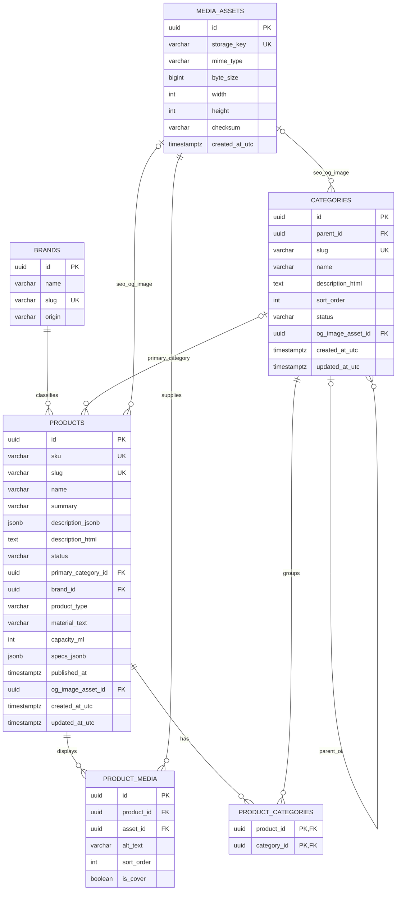

# Catalog + Media database

Phạm vi hiện tại chỉ gồm 6 bảng Catalog + Media. Identity, Content, Leads, Analytics, Settings và Commerce chưa được tạo trong migration `InitialCatalog`.

## ERD

`products` và `categories` còn có các cột SEO nằm ngay trong bảng owner: `seo_title`, `meta_description`, `canonical_override`, `robots_index`, `og_title`, `og_description`, `og_image_asset_id`. Trong C#, các cột này được map từ owned value object `SeoMetadata`; không có bảng SEO polymorphic.

## Tóm tắt thiết kế

| Entity | Vai trò | Lý do thiết kế |
|---|---|---|
| `products` | Dữ liệu catalog và lifecycle Draft/InReview/Published/Archived. | Các trường cần filter/constraint là cột riêng; description/specs linh hoạt dùng `jsonb` nhưng bị giới hạn là JSON object. Không có `is_published` trùng lặp. |
| `categories` | Cây danh mục và nội dung landing page. | Self-FK dùng `RESTRICT`; index `(parent_id, sort_order)` phục vụ duyệt cây có thứ tự. |
| `product_categories` | Quan hệ nhiều-nhiều giữa product và category. | Composite PK ngăn liên kết trùng; cascade chỉ dọn link row khi product/category được xóa hợp lệ. |
| `brands` | Thương hiệu tùy chọn của product. | `slug` unique; `origin` nullable để không suy đoán xuất xứ. Xóa brand đang được tham chiếu bị chặn. |
| `media_assets` | Metadata object media, độc lập storage provider. | `storage_key` unique; kích thước/dimensions dương; chưa chứa logic R2 hoặc upload pipeline. |
| `product_media` | Gallery product với ALT, thứ tự và cover. | Partial unique index bảo đảm tối đa một cover mỗi product; product delete dọn gallery row, asset delete bị chặn nếu còn tham chiếu. |

## Constraints và index quan trọng

- Unique: `products.slug`, SKU khi khác `NULL`, `categories.slug`, `brands.slug`, `media_assets.storage_key`.
- Query indexes: `products(status, published_at)`, `categories(parent_id, sort_order)`, `product_categories(category_id)`, `product_media(product_id, sort_order)`.
- Cover: `UNIQUE (product_id) WHERE is_cover = TRUE`.
- JSONB: PostgreSQL kiểm tra JSON hợp lệ theo kiểu `jsonb`; check constraints yêu cầu `description_jsonb` và `specs_jsonb` là object.
- Timestamps dùng `timestamptz`; entity tạo thời gian UTC và database có `now()` default cho insert trực tiếp.

Migration không được chạy tự động khi API Production startup. Production migration phải là deploy step riêng, có review SQL và backup.
